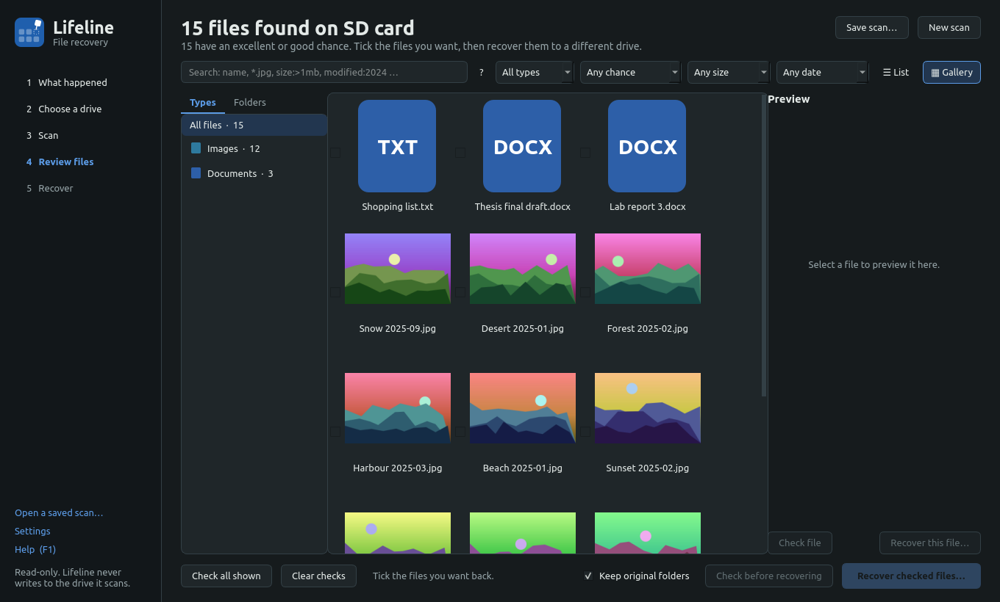
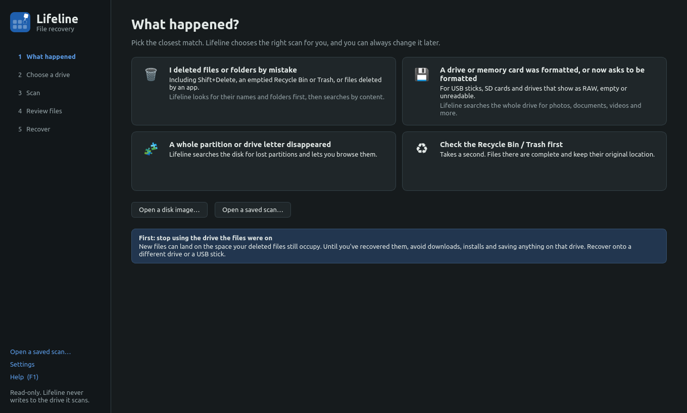
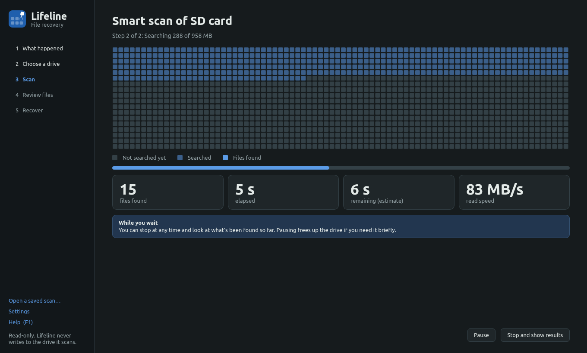
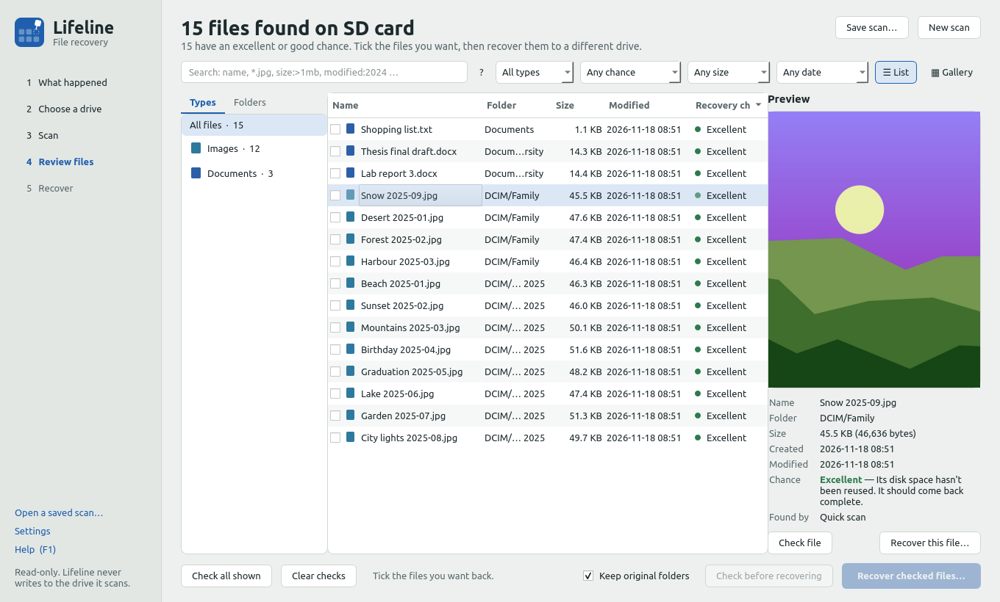
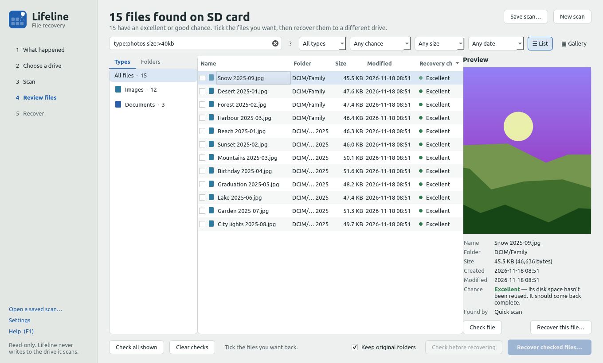

<div align="center">


# Lifeline

**Deleted isn't gone.** Get back deleted photos, documents and whole folders from drives, USB sticks and memory cards.<br>
A guided desktop app and a command-line tool for Windows, macOS and Linux.

[**Website**](https://ojas1024.github.io/LifeLine/) · [Get started](#get-started) · [Features](#what-it-does) · [Command line](#command-line) · [How it works](#how-it-works)




</div>

---

## Why Lifeline

When a file is deleted, its data usually stays on the drive until something new is written over it. Lifeline finds that data and
copies it somewhere safe. You don't need to know what an MFT or file carving is: Lifeline asks **what happened** and picks
the right scan for you.

|  | |
|---|---|
| 🗑 **I deleted files by mistake** | Finds them with their **original names and folders**, then searches free space for anything else. |
| 💾 **A drive or card was formatted** | Searches every block for 20 families of file formats, by content. |
| 🧩 **A partition disappeared** | Searches the disk for lost partitions and lets you browse them like a normal drive. |
| ♻ **Check the Recycle Bin first** | Lists what's still in the Recycle Bin / Trash on every OS, with original locations. |

It only ever **reads** from the drive it scans, and it refuses to save recovered files onto that same drive.

## Get started

> **Recovering right now?** Stop saving anything to the drive you lost files from, and don't install Lifeline on it.
> Every new file can land on top of the ones you want back.

```bash
git clone https://github.com/Ojas1024/LifeLine.git
cd LifeLine
pip install -r requirements.txt      # PyQt6
```

Or install it from PyPI and get a `lifeline` command:

```bash
pip install lifeline-recovery
lifeline            # the app
lifeline --help     # the command line
```

| System | Start it |
|---|---|
| **Windows** | double-click `run.bat` (it asks for administrator rights), or `python -m lifeline` in an admin terminal |
| **Linux** | `./run.sh`: the app offers to restart itself with admin rights (pkexec), or run `sudo -E python3 -m lifeline` |
| **macOS** | `./run.sh`: the app asks for your password. Also allow Full Disk Access for it in *System Settings → Privacy & Security* |
| **pip** | `pip install lifeline-recovery`, then just `lifeline` |

**Portable builds.** `build_exe.bat` gives `dist\Lifeline.exe`, one file that asks for admin rights on launch.
`./build.sh` gives `dist/Lifeline` on Linux or `dist/Lifeline.app` on macOS. Put the build on a USB stick and run it from there.

## What it does

<table>
<tr>
<td width="50%"></td>
<td width="50%"></td>
</tr>
<tr>
<td><b>Guided start.</b> Four plain choices set the scan up for you. Advanced options stay folded away.</td>
<td><b>Live scan.</b> A map of the drive fills in as it's searched, with the files found, read speed and time left. Pause or stop any time.</td>
</tr>
<tr>
<td></td>
<td></td>
</tr>
<tr>
<td><b>Plain recovery chances.</b> Each file is <i>Excellent</i>, <i>Good</i>, <i>Poor</i> or <i>Unlikely</i>, with a preview and a warning when an SSD has already erased it.</td>
<td><b>Real search.</b> <code>*.docx</code>, <code>type:photos</code>, <code>size:&gt;5mb</code>, <code>modified:2024</code>, <code>in:Documents</code>, <code>-backup</code>, regex, plus filters and a folder tree.</td>
</tr>
</table>

### Scans

- **Quick scan** keeps **names, folders and dates**:
  - **NTFS:** parses the MFT on every CPU core, rebuilds paths through deleted folders, handles fragmented files, extension records, an `$ATTRIBUTE_LIST` on the MFT, and a damaged boot sector (by falling back to the backup copy).
  - **FAT12/16/32:** goes into deleted folders, rebuilds long file names, and recovers the lost first letter of the short name when the checksum allows.
  - **exFAT:** reads deleted entry sets, lays out contiguous (NoFatChain) files exactly, and corrects timestamps to UTC.
  - Every file is checked against the allocation bitmap or FAT, so you can see whether its space has been reused.
- **Deep scan** (file carving) works after formatting and on any file system. It walks each format's internal structure to find where the file really ends, and drops random matches:

  JPEG · PNG · GIF · BMP · TIFF & camera RAW (CR2, NEF, ARW, DNG, ORF) · PSD · PDF · ZIP family (DOCX, XLSX, PPTX, ODT, EPUB, JAR, APK, ZIP64) ·
  DOC/XLS/PPT/MSG/MSI · RAR4 & RAR5 · 7-Zip · MP4/MOV/HEIC/AVIF/CR3 · MKV/WebM · WMV/WMA · WAV/AVI/WebP · MP3 · Ogg/Opus · FLAC · SQLite · EXE/DLL

  The work is split across worker processes, each with its own read handle. One worker searches about 0.5–1.1 GB/s of data, and on NTFS/FAT/exFAT the scan can stay in free space.
- **Smart scan** runs a quick scan, then a deep scan. A file found by both is listed once, under its real name.
- **Lost partitions:** searches MBR (with logical partitions) and GPT tables, then every 1 MiB boundary, the 63-sector offset and the NTFS backup boot sector. Each candidate is opened read-only before it's offered to you.
- **Recycle Bin / Trash:** Windows `$Recycle.Bin`, freedesktop Trash on Linux (including per-drive `.Trash-UID`), and `~/.Trash` on macOS.

### Recovering

- **Check before recovering.** Reads the files and tests whether their structure is intact (ZIP and PNG CRCs, JPEG scan data, PDF xref, SQLite `integrity_check`, RAR/7z/Ogg checksums, …) without writing anything.
- **Several files are copied at once.** Original folders and timestamps are kept, each file can be checked again after it's written, and a CSV report lists everything.
- **Never onto the source drive.** Lifeline checks the drive letter or physical disk on Windows, partitions, disks and device-mapper on Linux, and the APFS physical store on macOS.
- **Save the scan** to a `.lifeline` file and pick up later, even after the disk image has moved.
- **Failing drives.** *Make an image of a drive* copies healthy areas first, retries damaged ones 4 KB at a time at the end, and resumes if interrupted. During scans a bad sector costs 4 KB, not the whole read.
- Light and dark themes that follow the system, drag-and-drop for disk images, keyboard shortcuts (Ctrl+F, Space, Ctrl+R, Ctrl+S, F1) and a built-in help screen.

## Command line

Everything the app does is also available from a terminal:

```bash
lifeline list --disks                                    # drives and whole disks
lifeline scan D: --out E:\Recovered                      # smart scan of a Windows drive
lifeline scan /dev/sdb1 --mode quick --query "*.docx modified:2024" --out ~/Recovered
lifeline scan card.img --mode deep --types jpg,mp4 --workers 8 --save card.lifeline
lifeline load card.lifeline --query "type:photos" --verify --out ~/Recovered
lifeline partitions /dev/sdb --search                    # find lost partitions
lifeline scan /dev/sdb --partition 0 --include-existing  # browse one of them
lifeline trash --out ~/Recovered                         # restore the Recycle Bin
lifeline image /dev/sdb /mnt/usb/sdb.img                 # resumable, bad-sector tolerant
```

## How it works

```
lifeline/
  core/
    disk.py         sector-aligned raw reads on Windows, Linux and macOS; bad-sector salvage; imaging
    devices.py      drive listing (Win32 IOCTLs, lsblk, diskutil), admin rights, same-drive safety check
    filesystems.py  common interface   ntfs.py · fat.py · exfat.py   deleted-entry parsers
    partitions.py   MBR / EBR / GPT and lost-partition search
    carver.py       signature search + structure-aware extractors, parallel engine
    verify.py       integrity checks        trash.py   Recycle Bin / Trash
    query.py        search language         session.py smart scan, dedupe, verify, save/load
    recovery.py     parallel, verified recovery with a CSV report
    parallel.py     process pools (spawn) with per-worker read handles
  ui/               guided pages, results browser, gallery thumbnails, light/dark theme
  cli.py            command line
tests/              153 tests
```

**Deleting a file** marks its record free and its clusters available, but the data stays where it was. The quick scan reads those
records back: NTFS MFT entries, FAT `0xE5` entries, exFAT entry sets with the in-use bit cleared. It rebuilds the
folder tree and checks each file's clusters against the allocation map. **The deep scan** doesn't rely on records at all. It looks
for file headers at cluster boundaries, then follows each format's structure (JPEG segments, ZIP central directory, MP4 boxes,
RAR blocks, Ogg pages, …) to the true end of the file.

### Tests

```bash
pip install pytest && python -m pytest
```

The 153 tests run on:
- real FAT images with real deletions (mtools) and NTFS images (`mkntfs`/`ntfscp`)
- synthetic exFAT images and MBR/GPT disks
- every carved format, at two block sizes, with junk headers and noise between files
- parallel vs. sequential equivalence, plus an offscreen run of the whole GUI: open an image, smart scan, search, gallery, recover, compare bytes.

The suite and the GUI were run on Linux. On Windows and macOS, device listing, admin rights and the same-drive check go through
those systems' own APIs. The scan engines are the same Python code on all three.

## Limits

- **SSDs with TRIM** (the default) erase deleted blocks within minutes. Files may appear by name but read back as zeros. Lifeline warns when it sees this. No software can undo TRIM.
- Deep scan assumes each file is stored in one piece, so fragmented files come back damaged and without names. Quick scan doesn't have this problem.
- A deleted FAT file that only had a short 8.3 name loses its first letter (shown as `_`), because that letter isn't stored anywhere.
- Quick scan supports NTFS, FAT and exFAT. ext4, APFS, HFS+ and Btrfs get deep scan only.

---

<div align="center">
Made by <a href="https://ojas1024.github.io/">Ojas Gupta</a>
</div>
